# agent-task-metering

> Track and meter AI agent task intent handling and task adherence — bill outcomes, not attempts.

[](https://github.com/ctava-msft/agent-task-metering/actions/workflows/ci.yml)
[](LICENSE)

---

## 📚 Table of Contents

- [Problem Statement](#-problem-statement)
- [What Is agent-task-metering?](#-what-is-agent-task-metering)
- [Key Benefits for Cost Management](#-key-benefits-for-cost-management)
- [How It Works](#-how-it-works)
- [Quick Start](#-quick-start)
- [End-to-End Example Walkthrough](#-end-to-end-example-walkthrough)
- [Repository Layout](#repository-layout)
- [Documentation](#documentation)
- [Contributing](#contributing)

---

## 🌍 Problem Statement

AI agents are increasingly used to automate complex tasks — from summarizing reports and answering support tickets to orchestrating multi-step workflows. As organizations deploy these agents at scale through the **Azure**, a critical challenge emerges:

**How do you fairly and accurately bill customers for the work AI agents perform?**

### The Billing Challenge Today

Today, most AI platforms charge based on **resource consumption** (e.g., tokens, API calls, compute time) rather than **task outcomes**. This creates several problems:

| Problem | Impact | Real-World Example |
|---|---|---|
| **Billing for failed tasks** | Customers pay for work that delivered no value | An agent processes 10,000 tokens trying to generate a report but times out before producing any output. The customer is billed for the tokens, but received nothing. |
| **No outcome verification** | Charges cannot be justified or audited | A customer's invoice shows 500 "task completions" but there is no evidence trail showing whether those tasks actually succeeded or produced valid results. A billing dispute follows. |
| **Duplicate billing** | The same task is charged multiple times | An agent retries a task 3 times due to transient failures. Each retry is metered as a separate event, tripling the customer's cost for a single logical task. |
| **Unpredictable costs** | No guardrails against runaway billing | A misconfigured agent enters a loop and completes 10,000 tasks in one hour. The customer receives a massive surprise invoice with no cap protection. |
| **No aggregation control** | Per-event billing is noisy and hard to reconcile | Instead of one clean hourly usage event, the Marketplace receives thousands of individual events, making billing reconciliation painful for both publisher and customer. |

### A Concrete Scenario

Consider **Contoso Corp**, an ISV that sells an AI-powered document processing agent through the Azure Marketplace. Their agent handles tasks like:

- Summarizing legal contracts
- Extracting key terms from invoices
- Generating compliance reports

**Without `agent-task-metering`:**

```
Hour: 2025-06-01 14:00 UTC
─────────────────────────────────────────────────────────────
Task-001: Summarize contract     → Completed ✅  (billed)
Task-002: Extract invoice terms  → Completed ✅  (billed)
Task-003: Generate report        → TIMED OUT ❌  (still billed — 8,000 tokens consumed)
Task-004: Summarize contract     → Completed ✅  (billed — but this was a RETRY of Task-001!)
Task-005: Extract terms          → Empty output  (billed — output was blank)
─────────────────────────────────────────────────────────────
Customer billed for: 5 tasks
Customer should pay for: 2 tasks (Task-001 and Task-002)
Overbilling: 150%
```

The customer disputes the charges. Contoso has no audit trail to reconstruct what happened. The dispute process is manual, expensive, and damages trust.

**With `agent-task-metering`:**

```
Hour: 2025-06-01 14:00 UTC
─────────────────────────────────────────────────────────────
Task-001: Summarize contract     → ✅ BILLABLE  (intent resolved, outputs valid)
Task-002: Extract invoice terms  → ✅ BILLABLE  (intent resolved, outputs valid)
Task-003: Generate report        → ❌ NOT BILLABLE (terminal_success: failed)
Task-004: Summarize contract     → ❌ DUPLICATE  (same task_id in same hour — ignored)
Task-005: Extract terms          → ❌ NOT BILLABLE (output_validation: empty_value)
─────────────────────────────────────────────────────────────
Usage event submitted:
  { subscription: "sub-contoso-001", dimension: "task_completed",
    quantity: 2, hour: "2025-06-01T14:00:00Z" }

Customer billed for: 2 tasks (exactly what they should pay for)
Audit trail: Every decision has a correlation ID and evidence record
```

---

## 🤖 What Is agent-task-metering?

`agent-task-metering` is a lightweight Python library that evaluates AI agent task completions against a **deterministic adherence contract** and meters only the tasks that provably delivered value. It integrates with the [Azure Marketplace Metered Billing API](https://learn.microsoft.com/azure/marketplace/marketplace-metering-service-apis) to produce accurate, dispute-resistant billing.



### Core Capabilities

| Capability | What It Does |
|---|---|
| **Task Adherence Evaluation** | Runs 5 sequential deterministic gates (intent resolution, terminal success, required outputs, output validation, approval) to decide if a task is billable |
| **Outcome-Based Billing** | Only tasks that pass all gates are billed — failed, incomplete, or empty-output tasks are never charged |
| **Duplicate Protection** | Same `(subscription, task_id, hour)` is recorded only once — retries and replays don't inflate costs |
| **Hourly Aggregation** | Consolidates N task completions into a single usage event per subscription per hour, as required by the Marketplace API |
| **Guardrail Caps** | Configurable per-subscription hourly and daily limits prevent runaway billing from misconfigured agents |
| **Full Audit Trail** | Every evaluation decision is persisted with a correlation ID, evidence, and gate results for billing reconstruction |

---

## 💰 Key Benefits for Cost Management

### 1. Eliminate Overbilling with Outcome-Based Metering

**Current model (token/API-call billing):** Customers pay for every API call or token consumed, regardless of whether the task succeeded.

**With agent-task-metering:** Customers pay only for tasks that completed successfully with valid outputs.

**Example — Monthly cost comparison for a customer running 10,000 agent tasks/month:**

```
                          Token-Based Billing    Outcome-Based Billing
                          ───────────────────    ─────────────────────
Total tasks attempted:          10,000                 10,000
Failed/timed-out tasks:          1,500                  1,500  → NOT billed
Empty-output tasks:                800                    800  → NOT billed
Duplicate/retry tasks:             700                    700  → NOT billed
                                ───────                ───────
Tasks actually billed:          10,000                  7,000
                                                        ─────
Cost savings:                                           30% reduction
```

### 2. Prevent Billing Disputes Before They Happen

Every billed task carries a full **audit record** with:
- The original evidence (query, response, outputs)
- Each gate's pass/fail result with reason codes
- A unique correlation ID that traces through evaluation → recording → aggregation → submission

**Example — Responding to a customer dispute:**

```python
# Customer asks: "Why was task-042 billed?"
record = evaluator.audit_store.get("correlation-id-abc123")

# Returns:
# {
#   "task_id": "task-042",
#   "intent_handled": true,
#   "adhered": true,
#   "billable_units": 1,
#   "reason_codes": [
#     "intent_resolution:passed",
#     "terminal_success:passed",
#     "required_outputs:skipped",
#     "output_validation:passed",
#     "approval:skipped"
#   ],
#   "evidence": {
#     "query": "Summarize the Q3 financials",
#     "response": "Revenue increased 12% YoY...",
#     "outputs": {"status": "completed", "result": "Summary generated"}
#   }
# }
```

Every charge can be justified with evidence. No more "trust us" billing.

### 3. Control Costs with Guardrail Caps

Protect customers (and yourself) from runaway billing caused by agent loops or misconfigurations:

```python
from agent_task_metering.metering.client import GuardrailConfig, MarketplaceMeteringClient

client = MarketplaceMeteringClient(
    guardrail_config=GuardrailConfig(
        hourly_cap=100,   # max 100 tasks per subscription per hour
        daily_cap=1000,   # max 1,000 tasks per subscription per day
    ),
)

# If an agent enters a loop and tries to record 5,000 tasks in one hour:
# → Only the first 100 are recorded
# → Remaining 4,900 are blocked and logged as AnomalyRecords
# → Customer is protected from a surprise $X,000 invoice
```

### 4. Simplify Billing Reconciliation

Instead of thousands of individual metering events, the library produces **one clean usage event per subscription per hour**:

```
Without aggregation (raw events):        With aggregation:
─────────────────────────────────        ──────────────────────
POST /usageEvent  task-001               POST /usageEvent
POST /usageEvent  task-002                 { subscription: "sub-001",
POST /usageEvent  task-003                   quantity: 12,
...                                          hour: "14:00:00Z" }
POST /usageEvent  task-012
(12 API calls, 12 line items)            (1 API call, 1 line item)
```

### 5. Summary: Before vs. After

| Aspect | Without This Library | With agent-task-metering |
|---|---|---|
| Failed tasks | Billed (tokens consumed) | **Not billed** (terminal_success gate) |
| Empty outputs | Billed (API call made) | **Not billed** (output_validation gate) |
| Duplicate/retry tasks | Billed multiple times | **Billed once** (idempotency) |
| Runaway agents | Unlimited billing | **Capped** (guardrails) |
| Billing disputes | No evidence, manual review | **Full audit trail**, instant lookup |
| Usage events | One per task (noisy) | **One per hour** (aggregated) |
| Invoice line items | Hundreds/thousands | **Clean, predictable** |

---

## ⚙️ How It Works

The library implements a three-stage pipeline that sits between your agent runtime and the Azure Marketplace:

```
┌─────────────────────┐
│   Agent Runtime      │  (your agent completes a task)
└────────┬────────────┘
         │ task outputs + evidence
         ▼
┌─────────────────────────────────────┐
│  agent-task-metering                │
│                                     │
│  1. Evaluate (adherence contract)   │  ← 5 deterministic gates
│  2. Record   (task_completed)       │  ← only if billable
│  3. Aggregate (hourly buckets)      │  ← one event per sub per hour
│  4. Submit   (Marketplace API)      │  ← or dry-run
└────────┬────────────────────────────┘
         │ UsageEvent
         ▼
┌─────────────────────────────────────┐
│  Azure Marketplace Metered Billing  │
│  (Partner Center / Commerce)        │
└─────────────────────────────────────┘
```

### The 5 Adherence Gates

Every task is evaluated through these gates **in order**. A task is billable only when all required gates pass:

| Gate | Name | Required? | What It Checks | Example Failure |
|------|------|-----------|----------------|-----------------|
| 0 | Intent Resolution | Configurable | Was the user's intent understood? | Agent received garbled input and couldn't parse the request |
| 1 | Terminal Success | Yes | Did the task reach a success state? | Task timed out or crashed mid-execution |
| 2 | Required Outputs | Configurable | Are all expected output keys present? | Agent produced a `status` but no `result` field |
| 3 | Output Validation | Yes | Are output values non-null and non-empty? | `result` field exists but is an empty string `""` |
| 4 | Approval | Optional | Was the task explicitly approved? | Human-in-the-loop approval was required but not granted |

```
billable_units = 1   if intent_handled AND adhered (all gates pass)
billable_units = 0   otherwise (task is FREE — customer is not charged)
```

### Azure Marketplace Integration

The library is currently running in **dry-run mode** — it evaluates tasks and records them in-memory, but does not submit usage events to the Azure Marketplace Metered Billing API. To enable live billing, you need to:

1. **Publish a Marketplace offer** in [Partner Center](https://partner.microsoft.com/) with a `task_completed` custom meter dimension
2. **Set `dry_run=False`** on `MarketplaceMeteringClient`
3. **Provide a `submit_callback`** that POSTs to `https://marketplaceapi.microsoft.com/api/usageEvent`

---

## 🚀 Quick Start

### Requirements

- Python 3.9+
- Docker (optional, for container build)

### Install

```bash
pip install -e ".[dev]"
```

### Run Tests

```bash
make test
```

### Lint

```bash
make lint
```

### Build Container Image

```bash
make build
```

### Dev Container

Open this repository in VS Code and choose **Reopen in Container** to get a
fully configured Python development environment.

---

## 🔬 End-to-End Example Walkthrough

### Example 1: Basic Task Recording

Record agent tasks and get a summary of token usage across agents:

```python
from agent_task_metering import TaskMeter

meter = TaskMeter()

# Record tasks from two different agents
meter.record("task-001", "gpt-4o-agent", "chat", input_tokens=512, output_tokens=128)
meter.record("task-002", "gpt-4o-agent", "search", input_tokens=64, output_tokens=32)
meter.record("task-003", "phi-3-agent", "summarize", input_tokens=1024, output_tokens=256)

print(meter.summary())
# → {'total_tasks': 3, 'total_tokens': 2016, 'agents': ['gpt-4o-agent', 'phi-3-agent']}
```

### Example 2: Evaluate → Record → Aggregate → Submit (Full Pipeline)

This is the core workflow. An agent completes tasks, each task is evaluated, and only billable tasks are metered:

```python
from datetime import datetime, timezone
from agent_task_metering import (
    ContractConfig, EvaluationRequest, Evidence,
    MarketplaceMeteringClient, TaskAdherenceEvaluator,
)

# 1. Set up evaluator (with intent resolution enabled) and metering client
evaluator = TaskAdherenceEvaluator(
    config=ContractConfig(require_intent_resolution=True),
)
client = MarketplaceMeteringClient(dry_run=True, plan_id="basic")

# 2. A successful task — this WILL be billed
request_ok = EvaluationRequest(
    task_id="task-001",
    agent_id="agent-alpha",
    subscription_ref="sub-contoso-001",
    evidence=Evidence(
        query="Summarize the Q3 report",
        response="Revenue grew 12% YoY with strong margins...",
        outputs={"status": "completed", "result": "Summary generated successfully"},
    ),
)
result_ok = evaluator.evaluate(request_ok)
print(f"task-001: billable={result_ok.billable_units}")
# → task-001: billable=1  ✅

# 3. A failed task — this will NOT be billed
request_fail = EvaluationRequest(
    task_id="task-002",
    agent_id="agent-alpha",
    subscription_ref="sub-contoso-001",
    evidence=Evidence(
        query="Generate a chart",
        response="Chart generation attempted.",
        outputs={"status": "completed", "result": ""},  # empty result!
    ),
)
result_fail = evaluator.evaluate(request_fail)
print(f"task-002: billable={result_fail.billable_units}")
# → task-002: billable=0  ❌ (output_validation gate failed — empty value)

# 4. Record the billable task and aggregate
hour = datetime(2025, 6, 1, 14, 0, 0, tzinfo=timezone.utc)
client.record_task_completed("sub-contoso-001", "task-001", timestamp=hour)

# 5. Submit aggregated usage (dry-run prints the payload)
events = client.aggregate_and_submit("2025-06-01T14:00:00Z")
# → [UsageEvent(resourceId="sub-contoso-001", quantity=1,
#     dimension="task_completed", effectiveStartTime="2025-06-01T14:00:00Z")]
```

### Example 3: Hourly Aggregation — 12 Tasks → 1 Usage Event

```python
from datetime import datetime, timezone
from agent_task_metering.metering import MarketplaceMeteringClient

client = MarketplaceMeteringClient(dry_run=True, plan_id="basic")

# 12 task completions in the same hour for one subscription
hour = datetime(2025, 6, 1, 14, 0, 0, tzinfo=timezone.utc)
for i in range(1, 13):
    client.record_task_completed("sub-contoso-001", f"task-{i:03d}", timestamp=hour)

# Aggregate into a single usage event
events = client.aggregate_and_submit("2025-06-01T14:00:00Z")
print(f"Events: {len(events)}, Quantity: {events[0].quantity}")
# → Events: 1, Quantity: 12

# Duplicate task — silently ignored
dup = client.record_task_completed("sub-contoso-001", "task-001", timestamp=hour)
print(f"Duplicate recorded: {dup}")
# → Duplicate recorded: False
```

### Run the Full Demo

```bash
python examples/quickstart/run_quickstart.py
```

See [`examples/quickstart/README.md`](examples/quickstart/README.md) for details, or explore
[`examples/basic_usage.py`](examples/basic_usage.py) and
[`examples/hourly_aggregation.py`](examples/hourly_aggregation.py).

---

## Repository Layout

```
.
├── src/agent_task_metering/        # Library source
│   ├── evaluation/                 # Adherence contract & evaluator
│   │   ├── contract.py             # 5 deterministic gates
│   │   ├── evaluator.py            # Orchestrates evaluation + audit
│   │   ├── models.py               # Evidence, EvaluationRequest/Result
│   │   └── api.py                  # REST API (sidecar deployment)
│   ├── metering/
│   │   └── client.py               # Marketplace aggregation & submission
│   ├── meter.py                    # Task recording & token tracking
│   ├── models.py                   # TaskRecord data model
│   └── audit_logger.py             # Structured JSON audit logging
├── tests/                          # Unit tests (pytest)
├── docs/                           # In-depth documentation
├── examples/                       # Runnable usage examples
├── .devcontainer/                  # VS Code Dev Container config
├── .github/workflows/              # GitHub Actions CI
├── Makefile                        # Developer shortcuts
└── pyproject.toml                  # Project metadata and tool config
```

## Documentation

| Document | Description |
|---|---|
| [Architecture](docs/ARCHITECTURE.md) | How this repo pairs with an Azure Agents Control Plane |
| [Billing Dimensions](docs/BILLING_DIMENSIONS.md) | What is billable, hourly aggregation, dispute-resistant semantics |
| [Audit Logging](docs/audit-logging.md) | Structured logging and billing traceability |
| [Marketplace Checklist](docs/MARKETPLACE_CHECKLIST.md) | Steps to publish a Marketplace offer |
| [Reuse Documentation](docs/REUSE.md) | Which patterns are reused from Microsoft references |

## Contributing

This project welcomes contributions and suggestions. Please see
[CODE_OF_CONDUCT.md](CODE_OF_CONDUCT.md) and [SUPPORT.md](SUPPORT.md).

## Security

Please see [SECURITY.md](SECURITY.md) for reporting vulnerabilities.

## License

[MIT](LICENSE) © Microsoft Corporation

This repo reuses metering patterns from Microsoft's
[Metered Billing Accelerator](https://github.com/microsoft/metered-billing-accelerator)
and
[commercial-marketplace-solutions](https://github.com/microsoft/commercial-marketplace-solutions)
reference implementations.
